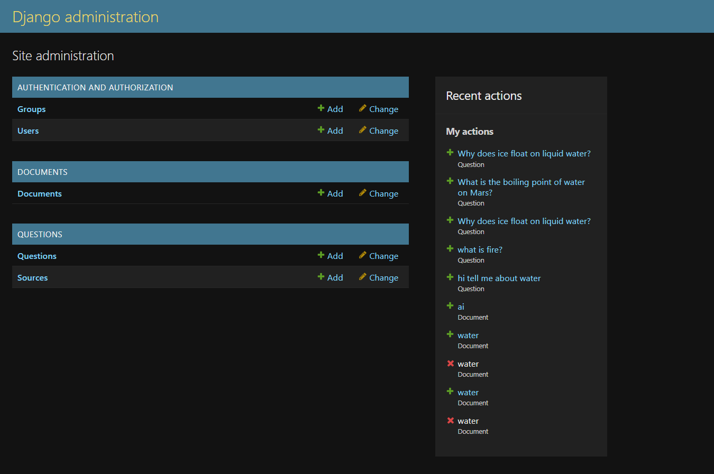
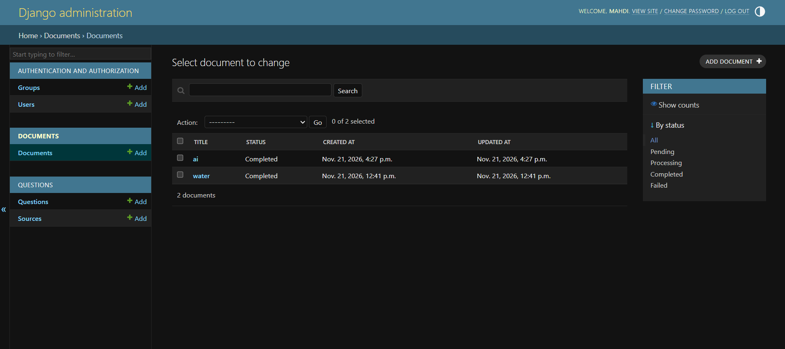
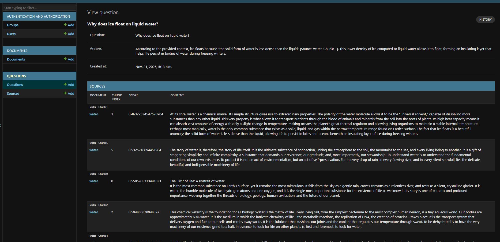
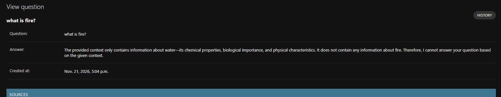

# Django RAG Document QA

A document-based Question Answering system built with Django and Retrieval-Augmented Generation (RAG). Users can upload documents, retrieve relevant content, and ask questions answered using the provided documents.

## Features

- DOCX document upload and text extraction
- Document management through Django Admin
- Document processing and chunking
- Multilingual semantic embeddings
- Persistent vector storage using ChromaDB
- Context retrieval for question answering
- LLM-powered answers using OpenRouter
- Question and answer history
- Retrieved source chunks associated with each question
- REST API for document management and question answering
- Docker-based deployment

## Technology Stack

- Python 3.11
- Django 5.2
- Django REST Framework
- LangChain
- ChromaDB
- Sentence Transformers
- OpenRouter
- SQLite
- Docker & Docker Compose
- pytest

## Architecture

The system follows a layered architecture separating application logic, domain logic, infrastructure, and Django application components.

- **Django** handles the web application, Admin interface, and REST API.
- **Document processing** extracts and processes text from uploaded documents.
- **Sentence Transformers** generates multilingual embeddings.
- **ChromaDB** stores embeddings and retrieves relevant document chunks.
- **LangChain** supports the retrieval-augmented question-answering pipeline.
- **OpenRouter** provides access to the language model used to generate answers.

## Requirements

- Docker Desktop
- An OpenRouter API key
- Internet connection (required for initial model download and LLM requests)

Python does not need to be installed on the host machine.

## Installation & Setup

### 1. Clone the repository

```bash
git clone https://github.com/mhnkz/rag-project.git
cd rag-project
```

### 2. Create the environment file

**Windows PowerShell:**

```powershell
Copy-Item .env.example .env
```

Edit `.env` and configure the required values:

```env
DJANGO_SECRET_KEY=your-secret-key
DEBUG=True

OPENROUTER_API_KEY=your-openrouter-api-key
OPENROUTER_MODEL=your-model-id
```

Other configuration values can be kept at their defaults for local development.

### 3. Build and run

```bash
docker compose up --build -d
```

Docker Compose builds the image, runs database migrations, and starts the Django server.

### 4. Create an administrator account

```bash
docker compose exec web python manage.py createsuperuser
```

Follow the prompts to create the administrator account.

### 5. Access the application

- **Django Admin:** http://127.0.0.1:8001/admin/
- **Question API:** http://127.0.0.1:8001/api/questions/ask/
- **Documents API:** http://127.0.0.1:8001/api/documents/

## Django Admin

The Django Admin interface provides document and question management.

- Upload and manage documents
- Process documents
- Ask questions using the RAG pipeline
- Review generated answers
- View retrieved source chunks
- Browse question history

## API Endpoints

### Questions

| Method | Endpoint | Description |
|---|---|---|
| POST | `/api/questions/ask/` | Ask a question using RAG |

### Documents

| Method | Endpoint | Description |
|---|---|---|
| GET | `/api/documents/` | List documents |
| GET | `/api/documents/<id>/` | Retrieve document details |
| POST | `/api/documents/upload/` | Upload a document |
| DELETE | `/api/documents/<id>/delete/` | Delete a document |

## Example: Ask a Question

**Endpoint:**

```http
POST /api/questions/ask/
```

**Request body:**

```json
{
    "question": "Why does ice float on liquid water?",
    "top_k": 3
}
```

The system retrieves relevant document chunks and generates an answer based on the retrieved context.

## Storage

Docker Compose uses persistent volumes for:

- SQLite database
- Uploaded documents
- ChromaDB vector storage
- Hugging Face model cache

These volumes preserve data across container restarts and recreation.

## Running Tests

```bash
docker compose exec web pytest
```

## License

This project was developed as an academic project.

## Screenshots

### Django Admin Dashboard


### Document Management


### Grounded Answer


### Relevance Guard

